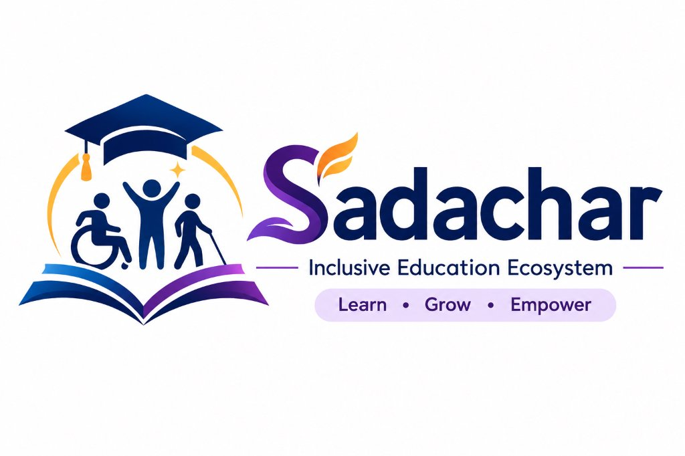

# Sadachar (सदाचार) — Education Without Barriers.

<p align="center">
  
</p>

> **Inclusive Education Ecosystem for Specially-Abled Students**  
> *Education Without Barriers. Automating Compliance (RPwD Act 2016, WCAG 2.2), Enforcing Governance (72-Hour Grievance SLAs), and Monitoring Safe Digital Conduct (DPDP Act 2023).*

---

## 🏛️ Project Overview (Smart India Hackathon)

Educational institutions frequently struggle with three systemic governance gaps regarding Persons with Disabilities (PwD / Divyangjan):
1. **Compliance Blindspots**: Learning materials and institutional portals are uploaded without validating against **WCAG 2.2 Level AA** or India's **RPwD Act 2016** (Sections 40 & 42).
2. **Administrative Inertia**: Grievances filed by specially-abled students regarding physical or digital barriers often languish without accountability.
3. **Privacy & Safe Conduct Risks**: Inappropriate ableist conduct or harassment goes unmonitored, or monitoring systems violate privacy norms under India's **Digital Personal Data Protection (DPDP) Act 2023**.

**Sadachar** solves all three with an integrated .NET Clean Architecture ecosystem, turning the mission of **"Education Without Barriers."** into an enforceable, transparent reality.

---

## 🏗️ Architecture & Tech Stack

```text
Sadachar/
├── Sadachar.slnx
└── src/
    ├── SakshamGovernance.Core/            # Domain Entities, Enums, Interfaces
    │   ├── Entities/                      # ApplicationUser, ComplianceLog, GrievanceTicket, ConductLog
    │   ├── Enums/                         # UserRole, DisabilityType, TicketStatus, IncidentType
    │   └── Interfaces/                    # IComplianceRepository, IGrievanceRepository, ISlaEscalationService, ...
    ├── SakshamGovernance.Infrastructure/  # EF Core, SQL Server, Repositories, Background Daemon
    │   ├── Data/                          # ApplicationDbContext
    │   ├── Repositories/                  # ComplianceRepository, GrievanceRepository, ConductRepository
    │   └── Services/                      # SlaEscalationService, SlaEscalationBackgroundService
    └── SakshamGovernance.Web/             # ASP.NET Core Web API + Accessible Frontend
        ├── Controllers/                   # ComplianceController, GovernanceController, ConductController
        ├── DTOs/                          # Strictly-typed API Request & Response Contracts
        └── wwwroot/                       # Accessible Web Portal (High Contrast, Font Resizing, WCAG 2.2 AAA)
```

The solution, C# namespaces, output assemblies, and database are named **Sadachar**. The source folder and `.csproj` filenames retain their legacy `SakshamGovernance` names; the compiled assemblies and application namespaces use Sadachar.

- **Backend**: C# 14, .NET 10 / ASP.NET Core MVC and Web API, Entity Framework Core 10.
- **Database**: Microsoft SQL Server / LocalDB.
- **Security & Identity**: ASP.NET Core Identity with Role-Based Access Control (RBAC).
- **Background Automation**: Autonomous `BackgroundService` with `PeriodicTimer` for statutory 72-Hour SLA audits.
- **Accessible UI**: Razor views for MVC pages and a static portal built with semantic HTML5, Bootstrap 5.3, WCAG 2.2 keyboard navigation, high-contrast mode, and dynamic text scaling.

---

## 📜 Regulatory Alignment

### 1. RPwD Act 2016 & WCAG 2.2 Level AA
- Automatically computes weighted scores across:
  - Color Contrast (25%)
  - Alt-Text / Captions (25%)
  - Keyboard Navigability (25%)
  - ARIA Screen Reader Compatibility (25%)
- Scores $\ge 80.00\%$ receive institutional certification; scores below trigger remediation flags.

### 2. Statutory 72-Hour Grievance SLA
- Every grievance logged initializes `SLAExpiryDateTime = CreatedAt.AddHours(72)`.
- The autonomous background daemon (`SlaEscalationBackgroundService`) runs every 15 minutes.
- If $DateTime.UtcNow > SLAExpiryDateTime$ and status is `Open` or `InProgress`, the ticket transitions immediately to `Escalated` for Ombudsman intervention.

### 3. DPDP Act 2023 (Digital Personal Data Protection)
- **Pseudonymization (Section 4)**: Actor IDs are hashed using SHA-256 with an institutional salt before persistence.
- **Data Minimization (Section 8)**: Text snippets are sanitized to scrub PII (phone numbers, email addresses).
- **Storage Limitation**: Records carry a strict retention timestamp (`DataRetentionExpiryUtc`), purgeable via automated job.

---

## 🚀 Getting Started

### Prerequisites
- [.NET SDK](https://dotnet.microsoft.com/download) (.NET 10)
- SQL Server (or LocalDB installed with Visual Studio / VS Code)

### Run the Application

```bash
# 1. Restore & Build Solution
dotnet build Sadachar.slnx

# 2. Run the Web Application
dotnet run --project src/SakshamGovernance.Web/SakshamGovernance.Web.csproj
```

Once running:
- **Interactive Accessible Portal**: Open `http://localhost:5024` in your browser.
- **Swagger OpenAPI Documentation**: Open `http://localhost:5024/swagger`.
- **ASP.NET Core MVC / Razor example**: Open `https://localhost:7053/Home/Index` or `http://localhost:5024/Home/Index`.
- **Sign in / student registration**: Open `http://localhost:5024/Account/Login` or `/Account/Register`.

The existing API controllers remain available under `/api`. SQL Server LocalDB is configured by default for persistent local development. Set `UseInMemoryDatabase` to `true` only when you want temporary demo data.

### Local SQL Server database and accounts

The Development configuration uses SQL Server LocalDB with Windows authentication and the database name `SadacharDb`. `Trusted_Connection=True` connects as the Windows user running the app; no separate SQL password is stored. Start/inspect LocalDB with `sqllocaldb info MSSQLLocalDB`; the connection string is in `appsettings.json`. On first run, EF Core applies the checked-in migrations and creates the database and Identity tables.

To confirm which Windows account SQL Server is using and that the Sadachar database exists:

```powershell
sqlcmd -S "(localdb)\MSSQLLocalDB" -E -Q "SELECT SUSER_SNAME() AS WindowsLogin, DB_NAME() AS CurrentDatabase; SELECT name, state_desc FROM sys.databases WHERE name = 'SadacharDb';"
```

In SQL Server Management Studio, connect to `(localdb)\MSSQLLocalDB` using **Windows Authentication** under the Windows account you use to run the app, then expand **Databases > SadacharDb > Tables**. The `AspNetUsers` table contains application sign-in accounts; use `/Account/Login` to sign in with the email and password you registered there. These are separate from the Windows account used to connect to LocalDB.

```powershell
# From the repository root; install the EF command once if it is not already installed
dotnet tool install --global dotnet-ef --version 10.0.0
dotnet ef database update --project src/SakshamGovernance.Infrastructure/SakshamGovernance.Infrastructure.csproj --startup-project src/SakshamGovernance.Web/SakshamGovernance.Web.csproj
dotnet run --project src/SakshamGovernance.Web/SakshamGovernance.Web.csproj
```

Sign in at `/Account/Login`; create a student account at `/Account/Register`. Passwords are hashed by ASP.NET Core Identity and are never stored as plain text. New self-registered accounts have student access only; an administrator must provision educator accounts. The seeded showcase student has no demo password—register an account to test sign-in.

The login cookie protects the account profile and APIs. Students can create and view only their own grievances; educator, administrator, and auditor access is checked from the account role stored in `AspNetUsers`.

For a different local database, keep connection strings out of source control and use .NET User Secrets:

```powershell
dotnet user-secrets init --project src/SakshamGovernance.Web/SakshamGovernance.Web.csproj
dotnet user-secrets set "ConnectionStrings:DefaultConnection" "YOUR_LOCAL_SQL_SERVER_CONNECTION_STRING" --project src/SakshamGovernance.Web/SakshamGovernance.Web.csproj
```

Do not post database passwords or secret connection strings in chat or commit them to GitHub.

---

## 📡 Core API Endpoints

### Compliance (`/api/compliance`)
- `POST /api/compliance/evaluate`: Submit accessibility scores for educational materials.
- `GET /api/compliance/material/{materialId}`: Audit history for specific course material.
- `GET /api/compliance/all`: Institutional compliance logs.

### Governance & SLA (`/api/governance`)
- `POST /api/governance/grievance`: File a grievance and activate 72-hour SLA clock.
- `GET /api/governance/grievance/{ticketId}`: Retrieve grievance status with real-time breach check.
- `GET /api/governance/grievances`: View all student grievances.
- `POST /api/governance/grievance/trigger-sla-check`: Manual trigger for the SLA escalation engine.

### Conduct & Privacy (`/api/conduct`)
- `POST /api/conduct/log-incident`: Anonymized incident logging with DPDP compliance.
- `GET /api/conduct/incidents`: Audit flagged harassment/ableist language incidents.
- `POST /api/conduct/purge-expired`: Enforce storage limitation and delete expired records.
